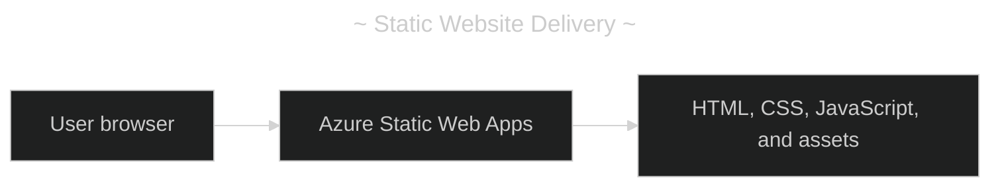
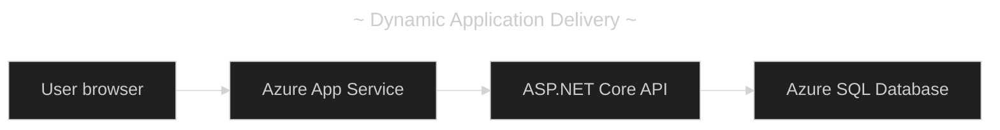
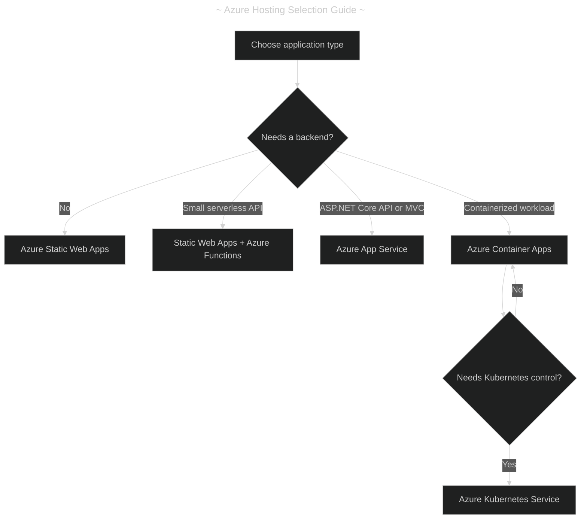
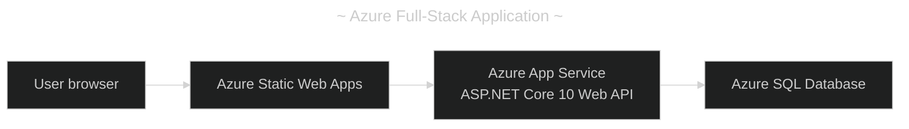
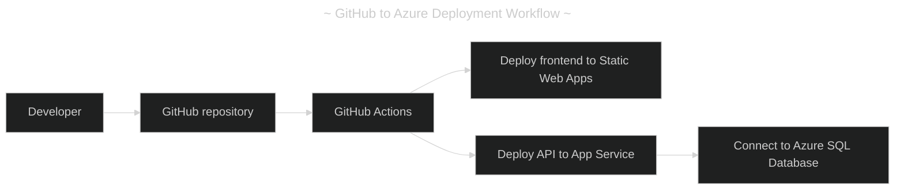

- [Azure Web Hosting Options by Application Complexity](#azure-web-hosting-options-by-application-complexity)
  - [(1) Azure Hosting Options by Complexity](#1-azure-hosting-options-by-complexity)
  - [(2) Static Versus Dynamic Hosting](#2-static-versus-dynamic-hosting)
    - [(2.1) Static Hosting](#21-static-hosting)
    - [(2.2) Dynamic Hosting](#22-dynamic-hosting)
  - [(3) Hosting Decision Guide](#3-hosting-decision-guide)
  - [(4) Free-Tier Considerations](#4-free-tier-considerations)
  - [(5) Full-Stack ASP.NET Core and Angular/React Example](#5-full-stack-aspnet-core-and-angularreact-example)
  - [(6) GitHub and Azure Deployment Workflow](#6-github-and-azure-deployment-workflow)
    - [(6.1) Deployment Steps](#61-deployment-steps)
  - [(7) Recommendations by Project Type](#7-recommendations-by-project-type)
  - [(8) Official Azure Documentation and Links](#8-official-azure-documentation-and-links)
    - [(8.1) Azure Service Documentation](#81-azure-service-documentation)
    - [(8.2) Pricing and Free-Tier References](#82-pricing-and-free-tier-references)
    - [(8.3) Azure Management and Deployment Portals](#83-azure-management-and-deployment-portals)
  - [(9) Final Recommendations](#9-final-recommendations)

---

# Azure Web Hosting Options by Application Complexity

---

> Azure offers several ways to deploy websites and web applications, ranging from
> static HTML pages to enterprise applications with APIs, databases, containers,
> and microservices. The most important distinction is whether the application
> requires a server to execute code or can run entirely in the browser.

---

## (1) Azure Hosting Options by Complexity

| Level | Application Type                       | Recommended Azure Service         | Free Option            |
| ----: | -------------------------------------- | --------------------------------- | ---------------------- |
|     1 | Static HTML/CSS/JavaScript website     | Azure Static Web Apps             | Yes                    |
|     1 | Basic static website or files          | Azure Blob Storage                | Pay-as-you-go          |
|     2 | React / Angular / Vue SPA              | Azure Static Web Apps             | Yes                    |
|     3 | SPA with lightweight serverless API    | Static Web Apps + Azure Functions | Yes, within limits     |
|     4 | ASP\.NET Core MVC / Razor Pages        | Azure App Service                 | F1 Free                |
|     4 | ASP\.NET Core Web API                  | Azure App Service                 | F1 Free                |
|     5 | Full-stack application with SQL Server | App Service + Azure SQL Database  | Partial                |
|     6 | Dockerized web application / API       | Azure Container Apps              | Consumption free grant |
|     7 | Multiple containerized services        | Azure Container Apps              | Limited free grant     |
|     8 | Enterprise microservices / Kubernetes  | Azure Kubernetes Service (AKS)    | Infrastructure costs   |
|     9 | Fully customized server hosting        | Azure Virtual Machines            | Generally paid         |

These levels indicate increasing architectural and operational complexity, not
necessarily increasing application quality.

---

## (2) Static Versus Dynamic Hosting

### (2.1) Static Hosting

Static hosting delivers prebuilt HTML, CSS, JavaScript, images, and other assets
without a continuously running application server.

### (2.2) Dynamic Hosting

Dynamic hosting runs server-side code, business logic, and data access. A React
or Angular SPA can still be statically hosted when it retrieves changing data
from an API; static hosting describes frontend delivery, not whether the content
changes.

An ASP\.NET Core MVC application that renders HTML on the server generally
requires App Service or another service capable of running its .NET backend.

---

## (3) Hosting Decision Guide

Azure Static Web Apps is a strong fit for compiled Angular, React, and Vue
frontends that execute in the browser. Choose Azure App Service when server-side
rendering or custom server behavior is required.

---

## (4) Free-Tier Considerations

|   # | Service              | Free-Tier Details                                             | Main Limitation                                        |
| --: | -------------------- | ------------------------------------------------------------- | ------------------------------------------------------ |
|   1 | Static Web Apps Free | Static hosting, managed APIs, TLS, and limited custom domains | No SLA; usage and feature limits                       |
|   2 | App Service F1       | Shared compute for development and testing                    | CPU quotas and restricted features                     |
|   3 | Blob Storage         | Usage-based billing                                           | No integrated application authentication               |
|   4 | Azure Functions      | Consumption-based free grant                                  | Execution and resource limits                          |
|   5 | Container Apps       | Monthly consumption free grant                                | Charges beyond the grant and for dependent resources   |
|   6 | AKS                  | Free control plane option                                     | Worker nodes and supporting infrastructure incur costs |

For Azure Container Apps Consumption, the monthly grant includes 180,000
vCPU-seconds, 360,000 GiB-seconds, and 2 million HTTP requests per subscription.
For Azure SQL Database, the free offer covers up to 10 eligible databases per
subscription, subject to its published compute and storage limits.

---

## (5) Full-Stack ASP\.NET Core and Angular/React Example

For Angular or React with an ASP\.NET Core 10 Web API and SQL Server, deploy the
frontend, backend, and database independently.

Advantages include independent frontend and backend deployment, efficient
delivery of static files, separate backend scaling, and database credentials
remaining on the backend. With direct browser-to-API requests, configure
authentication, CORS, HTTPS, and database access controls appropriately.

---

## (6) GitHub and Azure Deployment Workflow

GitHub Actions can automate compilation, testing, and deployment.

### (6.1) Deployment Steps

1. Create an Azure subscription and resource group.
2. Create an Azure Static Web App for the Angular or React frontend.
3. Create an Azure App Service with an appropriate .NET runtime.
4. Create an Azure SQL Database when persistent relational storage is required.
5. Configure the API connection string with App Service application settings.
6. Connect the GitHub repository to Azure.
7. Configure GitHub Actions to build and deploy the frontend and backend.
8. Configure API URLs, authentication, and CORS as required.
9. Test the application through its public HTTPS endpoints.

---

## (7) Recommendations by Project Type

|   # | Project                            | Recommended Hosting    | Reason                               |
| --: | ---------------------------------- | ---------------------- | ------------------------------------ |
|   1 | Personal portfolio                 | Static Web Apps Free   | Simple deployment                    |
|   2 | Documentation website              | Static Web Apps Free   | Static content delivery              |
|   3 | React learning project             | Static Web Apps Free   | No application server required       |
|   4 | Angular learning project           | Static Web Apps Free   | Supports compiled SPAs               |
|   5 | ASP\.NET Core MVC test application | App Service F1         | Managed .NET runtime                 |
|   6 | ASP\.NET Core API test application | App Service F1         | Managed API hosting                  |
|   7 | Production business application    | App Service + database | Managed backend and persistent data  |
|   8 | Docker learning project            | Container Apps         | Managed container deployment         |
|   9 | Microservices project              | Container Apps         | Independent scaling and deployments  |
|  10 | Advanced Kubernetes application    | AKS                    | Kubernetes orchestration and control |

---

## (8) Official Azure Documentation and Links

### (8.1) Azure Service Documentation

|   # | Azure Service                      | Official Documentation                                                                                                 |
| --: | ---------------------------------- | ---------------------------------------------------------------------------------------------------------------------- |
|   1 | Azure hosting overview             | [Hosting applications on Azure](https://learn.microsoft.com/azure/developer/intro/hosting-apps-on-azure)               |
|   2 | Azure Static Web Apps              | [Azure Static Web Apps documentation](https://learn.microsoft.com/azure/static-web-apps/)                              |
|   3 | Azure Blob Storage static websites | [Static website hosting in Azure Storage](https://learn.microsoft.com/azure/storage/blobs/storage-blob-static-website) |
|   4 | Azure App Service                  | [Azure App Service documentation](https://learn.microsoft.com/azure/app-service/)                                      |
|   5 | Azure Functions                    | [Azure Functions documentation](https://learn.microsoft.com/azure/azure-functions/)                                    |
|   6 | Azure Container Apps               | [Azure Container Apps documentation](https://learn.microsoft.com/azure/container-apps/)                                |
|   7 | Azure SQL Database                 | [Azure SQL Database documentation](https://learn.microsoft.com/azure/azure-sql/database/)                              |
|   8 | Azure Kubernetes Service           | [Azure Kubernetes Service documentation](https://learn.microsoft.com/azure/aks/)                                       |
|   9 | Azure Virtual Machines             | [Azure Virtual Machines documentation](https://learn.microsoft.com/azure/virtual-machines/)                            |

### (8.2) Pricing and Free-Tier References

|   # | Resource                      | Official Link                                                                                       |
| --: | ----------------------------- | --------------------------------------------------------------------------------------------------- |
|   1 | Azure pricing calculator      | [Azure pricing calculator](https://azure.microsoft.com/pricing/calculator/)                         |
|   2 | Azure free services           | [Azure free account](https://azure.microsoft.com/free/)                                             |
|   3 | Static Web Apps plans         | [Static Web Apps hosting plans](https://learn.microsoft.com/azure/static-web-apps/plans)            |
|   4 | Static Web Apps quotas        | [Static Web Apps quotas](https://learn.microsoft.com/azure/static-web-apps/quotas)                  |
|   5 | App Service pricing           | [Azure App Service pricing](https://azure.microsoft.com/pricing/details/app-service/)               |
|   6 | Container Apps pricing        | [Azure Container Apps pricing](https://azure.microsoft.com/pricing/details/container-apps/)         |
|   7 | Azure SQL Database free offer | [Azure SQL Database free offer](https://learn.microsoft.com/azure/azure-sql/database/free-offer)    |
|   8 | AKS pricing                   | [Azure Kubernetes Service pricing](https://azure.microsoft.com/pricing/details/kubernetes-service/) |

### (8.3) Azure Management and Deployment Portals

|   # | Portal                   | URL                                               | Purpose                               |
| --: | ------------------------ | ------------------------------------------------- | ------------------------------------- |
|   1 | Azure portal             | <https://portal.azure.com>                        | Create and manage Azure resources     |
|   2 | Azure DevOps             | <https://dev.azure.com>                           | Repositories, pipelines, and projects |
|   3 | GitHub                   | <https://github.com>                              | Source code repositories              |
|   4 | GitHub Actions           | <https://github.com/features/actions>             | Automated builds and deployments      |
|   5 | Microsoft Learn          | <https://learn.microsoft.com>                     | Azure documentation                   |
|   6 | Azure pricing calculator | <https://azure.microsoft.com/pricing/calculator/> | Estimate deployment costs             |

---

## (9) Final Recommendations

|   # | Requirement                               | Recommended Service              |
| --: | ----------------------------------------- | -------------------------------- |
|   1 | Simplest possible static hosting          | Azure Static Web Apps            |
|   2 | Free React or Angular hosting             | Azure Static Web Apps Free       |
|   3 | Simple ASP\.NET Core application          | Azure App Service                |
|   4 | ASP\.NET Core application with SQL Server | App Service + Azure SQL Database |
|   5 | Serverless backend                        | Azure Functions                  |
|   6 | Docker-based deployment                   | Azure Container Apps             |
|   7 | Containerized microservices               | Azure Container Apps             |
|   8 | Advanced Kubernetes management            | AKS                              |
|   9 | Full control over the operating system    | Azure Virtual Machines           |

For a conventional SPA, MVC, Web API, or full-stack learning path, learn Static
Web Apps, App Service, and Azure SQL Database first. Move to Container Apps for
Docker-based projects, and introduce AKS once Kubernetes-specific requirements
justify the additional operational complexity.
