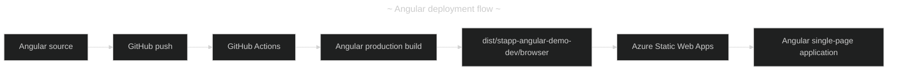

# Angular application deployment with Azure Static Web Apps

## Table of Contents

- [(1) Goal](#1-goal)
- [(2) Prerequisites](#2-prerequisites)
- [(3) Create the Angular application](#3-create-the-angular-application)
- [(4) Validate the local application](#4-validate-the-local-application)
- [(5) Configure Angular routing for Azure](#5-configure-angular-routing-for-azure)
- [(6) Determine the Azure build paths](#6-determine-the-azure-build-paths)
- [(7) Create the Static Web App](#7-create-the-static-web-app)
- [(8) Validate the generated workflow](#8-validate-the-generated-workflow)
- [(9) Verify the deployment](#9-verify-the-deployment)
- [(10) Troubleshooting](#10-troubleshooting)
- [(11) Clean up](#11-clean-up)
- [(12) References](#12-references)

---

## (1) Goal

Create an Angular single-page application and deploy it through GitHub Actions to Azure Static Web Apps. The lab covers Angular's build output, Azure's repository-relative paths, and the fallback required for client-side routes.



---

## (2) Prerequisites

|   # | Requirement                             | Purpose                                                | Situation   |
| --: | --------------------------------------- | ------------------------------------------------------ | ----------- |
|   1 | Active or maintenance LTS Node.js       | Runs Angular CLI and the application build             | ✅ Required |
|   2 | npm                                    | Installs packages and runs project scripts             | ✅ Required |
|   3 | Azure subscription                      | Creates the Static Web App resource                    | ✅ Required |
|   4 | GitHub repository                       | Hosts the Angular source and deployment workflow       | ✅ Required |
|   5 | GitHub repository admin or write access | Allows Azure to add the workflow and deployment secret | ✅ Required |
|   6 | `main` branch                           | Provides the production deployment branch              | ✅ Required |

Confirm the local tools before creating the project:

```powershell
node --version
npm --version
```

The commands display the installed Node.js and npm versions. Angular requires an active LTS or maintenance LTS Node.js release.

---

## (3) Create the Angular application

If `angular_test` already contains the Angular application, skip this section. Otherwise, run the following command from the root of the empty cloned repository to create the `ng-template-one` project directly at the repository root:

```powershell
npx @angular/cli@latest new ng-template-one --directory . --routing --style=scss --skip-git --package-manager=npm
```

|   # | Option                  | Purpose                                                        | Situation   |
| --: | ----------------------- | -------------------------------------------------------------- | ----------- |
|   1 | `@angular/cli@latest`   | Uses the current Angular CLI release                            | ✅ Lab setup |
|   2 | `--routing`             | Creates the application with Angular Router                     | ✅ Required for the routing exercise |
|   3 | `--style=scss`          | Uses SCSS for component and global styles                       | 🤔 Replace with the team's preferred format |
|   4 | `--skip-git`            | Prevents a nested Git repository inside the existing repository | ✅ Required in this workspace |
|   5 | `--package-manager=npm` | Records npm as the package manager                              | 🤔 Replace with `pnpm`, `yarn`, or `bun` if standardized |
|   6 | `--directory .`         | Creates the Angular workspace at the repository root            | ✅ Matches `app_location: "/"` |

Record the generated Angular version for reproducibility:

```powershell
npx ng version
```

---

## (4) Validate the local application

Start Angular's development server:

```powershell
npm start
```

Open <http://localhost:4200> and confirm that the starter application loads. Stop the development server with `Ctrl+C` before continuing.

Create a production build:

```powershell
npm run build
```

For a current Angular application that uses the application builder, the browser-deployable files normally appear under:

`dist/stapp-angular-demo-dev/browser`

Confirm that the directory contains `index.html`:

```powershell
Get-ChildItem -LiteralPath .\dist\stapp-angular-demo-dev\browser
```

The value in `angular.json` is authoritative. Check `projects.ng-template-one.architect.build.options.outputPath` if the output differs.

---

## (5) Configure Angular routing for Azure

Angular routes are evaluated in the browser. A direct request or refresh for a route such as `/about` reaches Azure first, so Azure must return `index.html` and allow Angular Router to handle the URL.

This project copies assets from `src/` rather than from a `public/` directory. Create `src/staticwebapp.config.json` with the following content:

```json
{
  "navigationFallback": {
    "rewrite": "/index.html",
    "exclude": [
      "/assets/*",
      "/*.{css,js,json,ico,png,jpg,jpeg,gif,svg,webp,woff,woff2,ttf,map}"
    ]
  }
}
```

Add the configuration file to `projects.ng-template-one.architect.build.options.assets` in `angular.json`:

```json
"assets": [
  "src/favicon.ico",
  "src/assets",
  "src/staticwebapp.config.json"
]
```

Rebuild and verify that Azure's configuration file is included:

```powershell
npm run build
Get-Item -LiteralPath .\dist\stapp-angular-demo-dev\browser\staticwebapp.config.json
```

The configuration must be present at the root of the deployed browser output, alongside `index.html`.

---

## (6) Determine the Azure build paths

Azure Static Web Apps interprets `app_location` relative to the repository root. It interprets `output_location` relative to `app_location`.

The portal has detected the Angular project in `QuVe-Services/angular_test`. Use the following values:

|   # | Portal field    | Visible or detected value   | Recommended value                       | Situation                                      |
| --: | --------------- | --------------------------- | --------------------------------------- | ---------------------------------------------- |
|   1 | Organization    | `QuVe-Services`              | `QuVe-Services`                         | ✅ GitHub organization                         |
|   2 | Repository      | `angular_test`               | `angular_test`                          | ✅ GitHub repository                           |
|   3 | Branch          | `main`                       | `main`                                  | ✅ Production branch                           |
|   4 | Build preset    | `Angular (detected)`         | Keep the detected preset                | ✅ Angular CLI application                     |
|   5 | App location    | `/`                          | `/`                                     | ✅ `package.json` is at the repository root    |
|   6 | API location    | Empty                        | Leave empty                             | ✅ No Azure Functions API                      |
|   7 | Output location | `dist/stapp-angular-demo-dev` | `dist/stapp-angular-demo-dev/browser` | ✅ Verified build directory containing `index.html` |

The local production build confirms that `index.html` is generated at `dist/stapp-angular-demo-dev/browser/index.html`. Therefore, use `dist/stapp-angular-demo-dev/browser` as Azure's `output_location`. The value configured in `angular.json` remains the base output path, `dist/stapp-angular-demo-dev`.

Use the following variations when the repository layout differs:

|   # | Repository layout                         | App location                 | Output location               | Situation                         |
| --: | ----------------------------------------- | ---------------------------- | ----------------------------- | --------------------------------- |
|   1 | Angular workspace at repository root      | `/`                          | `dist/stapp-angular-demo-dev/browser` | ✅ Current `angular_test` layout   |
|   2 | Angular workspace in `frontend/`           | `/frontend`                  | `dist/stapp-angular-demo-dev/browser` | 🤔 Common frontend/backend layout |
|   3 | Older Angular application without `browser` | Angular workspace directory | `dist/stapp-angular-demo-dev`         | 🤔 Confirm using the actual build |
|   4 | Customized `outputPath` in `angular.json`  | Angular workspace directory  | Configured browser output     | 🤔 Configuration is authoritative |

Do not prefix `output_location` with `app_location`. Azure interprets the output path relative to the application location.

---

## (7) Create the Static Web App

1. Commit and push the Angular application to the GitHub repository's `main` branch.
2. In the Azure portal, select **Create a resource**, then search for **Static Web Apps**.
3. Select **Create** and complete the **Basics** tab.

|   # | Field             | Recommended value                                           | Situation                                    |
| --: | ----------------- | ----------------------------------------------------------- | -------------------------------------------- |
|   1 | Subscription      | Your intended subscription                                  | ✅ Resource owner                            |
|   2 | Resource group    | `rg-ng-template-one-dev` or an existing learning group       | ✅ Logical grouping                          |
|   3 | Name              | A globally unique name such as `stapp-ng-template-one-dev-001` | ✅ Static Web App resource                 |
|   4 | Plan type         | `Free`                                                      | ✅ Suitable for this lab                     |
|   5 | Deployment source | `GitHub`                                                    | ✅ Enables CI/CD                             |
|   6 | Organization      | `QuVe-Services`                                             | ✅ GitHub organization                       |
|   7 | Repository        | `angular_test`                                              | ✅ Source repository                         |
|   8 | Branch            | `main`                                                      | ✅ Production branch                         |

4. In **Build Details**, enter the values from section (6).
5. Select **Preview workflow file** and confirm the paths before creating the resource.
6. In **Advanced**, leave managed API features disabled because this lab has no API.
7. Optionally add the tags `project=ng-template-one`, `environment=dev`, and `workload=learning`.
8. Select **Review + create**, then **Create**.

For reusable Azure naming guidance, see [Azure recommended names](../azure_recommended_names.md).

---

## (8) Validate the generated workflow

Azure creates a workflow under `.github/workflows/`. The generated workflow invokes Oryx, which may select npm even though this repository declares pnpm. Build the application explicitly with the pinned pnpm version, then deploy the prebuilt browser directory:

```yaml
- uses: actions/checkout@v6

- name: Set up pnpm
  uses: pnpm/action-setup@v6
  with:
    version: 11.17.0
    run_install: false

- name: Set up Node.js
  uses: actions/setup-node@v7
  with:
    node-version: 22
    cache: pnpm

- name: Install dependencies
  run: pnpm install --frozen-lockfile

- name: Build Angular application
  run: pnpm run build

- name: Build And Deploy
  uses: Azure/static-web-apps-deploy@v1
  with:
    azure_static_web_apps_api_token: ${{ secrets.AZURE_STATIC_WEB_APPS_API_TOKEN }}
    repo_token: ${{ secrets.GITHUB_TOKEN }}
    action: "upload"
    app_location: "dist/stapp-angular-demo-dev/browser"
    api_location: ""
    output_location: ""
    skip_app_build: true
```

With `skip_app_build: true`, `app_location` identifies the prebuilt content to deploy and `output_location` must be empty. Ensure the browser output also contains `staticwebapp.config.json`.

Confirm the following workflow behavior:

|   # | Check                                      | Expected result                                      | Situation   |
| --: | ------------------------------------------ | ---------------------------------------------------- | ----------- |
|   1 | Production trigger                         | A push to `main` starts a deployment                 | ✅ Required |
|   2 | Pull-request trigger                       | An eligible pull request creates a preview           | ✅ Expected |
|   3 | Pull-request close job                     | Closing the pull request removes its preview         | ✅ Expected |
|   4 | Deployment token                           | Workflow references Azure's generated GitHub secret  | ✅ Required |
|   5 | Build log                                  | pnpm installs dependencies and runs the Angular build | ✅ Required |

Do not manually rename or replace the generated deployment-token secret unless the Azure resource and GitHub secret are deliberately reconfigured together.

---

## (9) Verify the deployment

1. Open the repository's **Actions** tab and wait for the Azure Static Web Apps workflow to finish successfully.
2. Review the build log and confirm that Azure found the Angular output directory.
3. In the Azure portal, open the Static Web App's generated `*.azurestaticapps.net` URL.
4. Confirm that the Angular page loads with its JavaScript, styles, and assets.
5. Navigate to an Angular route, refresh the browser, and confirm that the route still loads instead of returning `404`.
6. Make a small change, push it to `main`, and verify that a new production deployment runs.
7. Open a pull request and verify that Azure creates a preview environment before merging.

---

## (10) Troubleshooting

|   # | Observation                                             | Likely cause                                        | Resolution                                                            | Situation                       |
| --: | ------------------------------------------------------- | --------------------------------------------------- | --------------------------------------------------------------------- | ------------------------------- |
|   1 | Workflow cannot find `package.json`                     | `app_location` does not point to the Angular workspace | Set it to the directory containing `package.json` and `angular.json` | ❌ Incorrect source path        |
|   2 | Workflow reports that the output folder is missing      | `output_location` does not match the Angular build  | Run `npm run build` and use the directory containing `index.html`     | ❌ Incorrect output path        |
|   3 | Oryx runs `npm install` and reports `edgesOut`          | Repository uses pnpm, but Oryx selected npm          | Build with pnpm explicitly and deploy with `skip_app_build: true`     | ❌ Wrong package manager        |
|   4 | Deployment succeeds but the site root returns `404`     | Parent output directory was deployed                | For Angular 17 or later, include the final `/browser` directory       | ❌ Wrong deployable directory   |
|   5 | Root page works but refreshing `/about` returns `404`    | No SPA navigation fallback                          | Deploy `staticwebapp.config.json` with an `index.html` rewrite        | ❌ Missing routing configuration |
|   6 | JavaScript or styles return `404`                        | Angular base URL or deployed directory is incorrect | Keep the default `<base href="/">` for a root-hosted Static Web App | ❌ Incorrect application base   |
|   7 | Build uses an unsupported Node.js version               | Local and cloud runtimes differ                      | Use an Angular-compatible LTS Node.js version and pin it in CI        | ❌ Runtime mismatch             |
|   8 | Repository is absent from the Azure portal selector     | GitHub authorization is missing or restricted        | Grant Azure Static Web Apps access to the repository                  | ❌ Authorization issue          |
|   9 | Old application content appears after deployment        | Browser or edge cache is serving a previous revision | Hard-refresh and confirm the deployed workflow revision               | 🤔 Caching                      |

The build output is the most reliable source for diagnosing path problems. The deployable directory must contain `index.html`, browser JavaScript bundles, styles, assets, and `staticwebapp.config.json`.

---

## (11) Clean up

When the lab is complete, delete the Static Web App resource or its dedicated resource group from the Azure portal. Deleting the Azure resource does not delete the GitHub repository.

If the deployment is no longer needed, also remove the generated workflow under `.github/workflows/` and its Azure deployment-token secret from the repository settings.

---

## (12) References

- <https://angular.dev/tools/cli/setup-local>
- <https://angular.dev/cli/new>
- <https://angular.dev/tools/cli/build>
- <https://angular.dev/tools/cli/deployment>
- <https://github.com/pnpm/action-setup>
- <https://learn.microsoft.com/azure/static-web-apps/deploy-angular>
- <https://learn.microsoft.com/azure/static-web-apps/build-configuration>
- <https://learn.microsoft.com/azure/static-web-apps/configuration>
