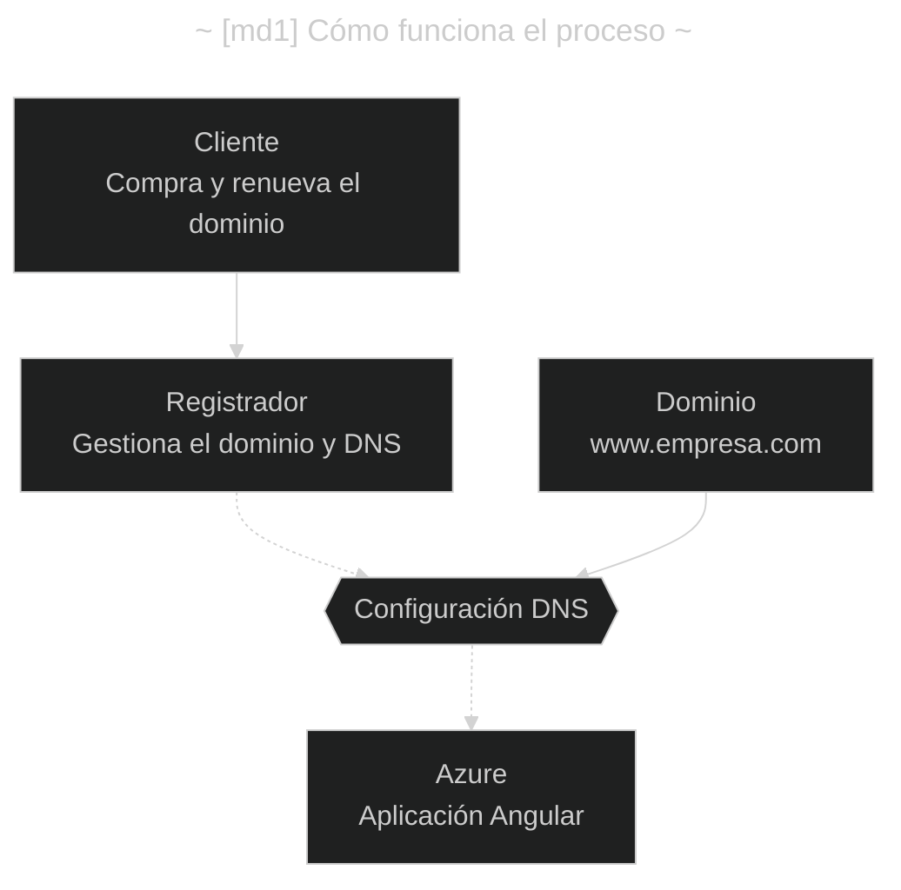
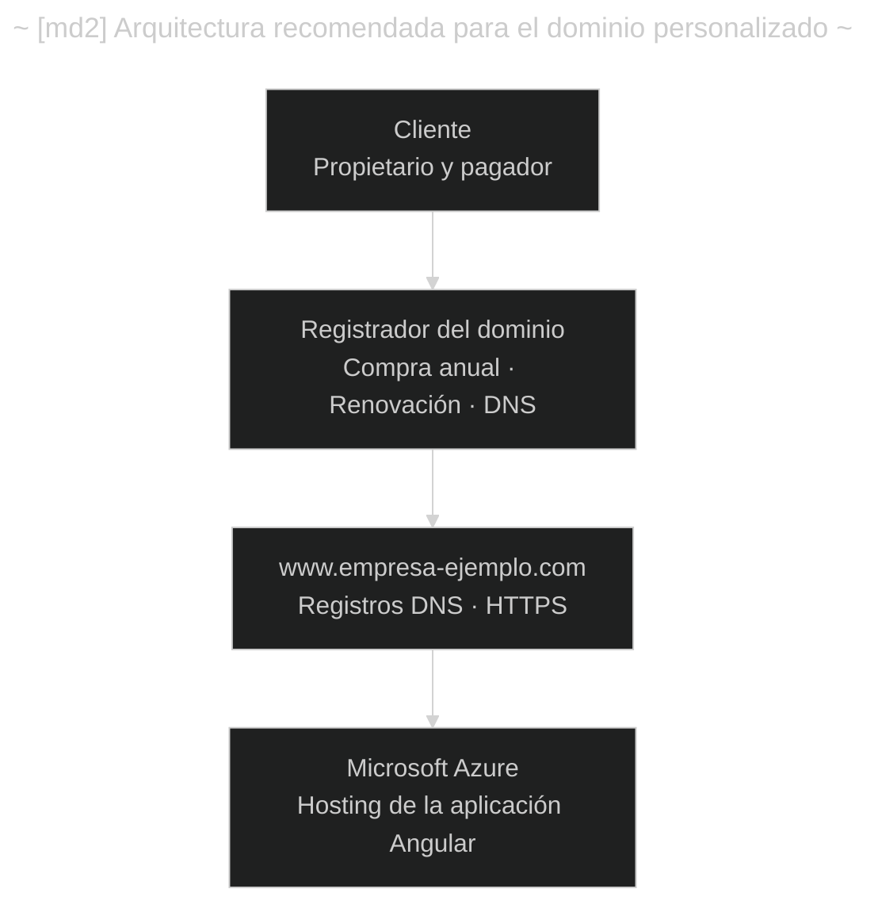

- [Cómo comprar y configurar un dominio personalizado para una aplicación Angular en Azure](#cómo-comprar-y-configurar-un-dominio-personalizado-para-una-aplicación-angular-en-azure)
  - [(s1) Cómo funciona el proceso](#s1-cómo-funciona-el-proceso)
  - [(s2) Qué paga el cliente](#s2-qué-paga-el-cliente)
  - [(s3) Procedimiento paso a paso para el cliente](#s3-procedimiento-paso-a-paso-para-el-cliente)
    - [(s3.1) Paso 1. Elegir el proveedor de dominios](#s31-paso-1-elegir-el-proveedor-de-dominios)
    - [(s3.2) Paso 2. Crear una cuenta a nombre del cliente](#s32-paso-2-crear-una-cuenta-a-nombre-del-cliente)
    - [(s3.3) Paso 3. Buscar el dominio y comprarlo](#s33-paso-3-buscar-el-dominio-y-comprarlo)
    - [(s3.4) Paso 4. Configurar el medio de pago](#s34-paso-4-configurar-el-medio-de-pago)
  - [(s4) Procedimiento técnico: conectar el dominio con Azure](#s4-procedimiento-técnico-conectar-el-dominio-con-azure)
    - [(s4.1) Paso 5. Identificar el servicio de Azure](#s41-paso-5-identificar-el-servicio-de-azure)
    - [(s4.2) Paso 6. Obtener el nombre de host de Azure](#s42-paso-6-obtener-el-nombre-de-host-de-azure)
    - [(s4.3) Paso 7. Configurar los registros DNS](#s43-paso-7-configurar-los-registros-dns)
    - [(s4.4) Paso 8. Agregar el dominio personalizado en Azure](#s44-paso-8-agregar-el-dominio-personalizado-en-azure)
    - [(s4.5) Paso 9. Configurar HTTPS y el dominio raíz](#s45-paso-9-configurar-https-y-el-dominio-raíz)
  - [(s5) ¿Quién es responsable de cada tarea?](#s5-quién-es-responsable-de-cada-tarea)
  - [(s6) ¿Se puede comprar el dominio directamente en Azure?](#s6-se-puede-comprar-el-dominio-directamente-en-azure)
  - [(s7) Recomendación final](#s7-recomendación-final)

---

# Cómo comprar y configurar un dominio personalizado para una aplicación Angular en Azure

> Tu planteamiento es correcto. Lo más recomendable es que el cliente compre el dominio utilizando una cuenta propia, lo pague con su tarjeta y conserve la titularidad y el control administrativo. Vos, como desarrollador, te encargás de vincular ese dominio con la aplicación Angular alojada en Azure.
>
> Hay una distinción importante: comprar un dominio no significa contratar otro servicio de hosting. Tu aplicación ya está alojada en Azure y, en principio, solamente necesitás que el dominio apunte a ella.

---

## (s1) Cómo funciona el proceso

El visitante accede por HTTPS al sitio en Azure.

---

## (s2) Qué paga el cliente

**[t1]**

| #    | Concepto                    | ¿Es necesario?                                    | Frecuencia                           |
| ---- | --------------------------- | ------------------------------------------------- | ------------------------------------ |
| `r1` | Registro del dominio        | Sí                                                | Generalmente anual                   |
| `r2` | Renovación del dominio      | Sí, para conservarlo                              | Generalmente anual                   |
| `r3` | Alojamiento en Azure        | Ya está contratado o configurado                  | Depende del plan                     |
| `r4` | Servicio DNS                | Sí, pero puede estar incluido sin cargo adicional | Variable                             |
| `r5` | Certificado HTTPS (SSL/TLS) | Sí, puede ser gratuito                            | Renovación automática según servicio |
| `r6` | Correo empresarial          | No, es opcional                                   | Generalmente mensual o anual         |

En consecuencia, el cliente no necesita necesariamente crear una suscripción a Azure ni contratar un nuevo hosting para comprar el dominio.

---

## (s3) Procedimiento paso a paso para el cliente

### (s3.1) Paso 1. Elegir el proveedor de dominios

El cliente puede utilizar un registrador independiente de Azure.

**[t2]**

| #     | Registrador          | Descripción                                                                       | Enlace                                           |
| ----- | -------------------- | --------------------------------------------------------------------------------- | ------------------------------------------------ |
| `r7`  | Cloudflare Registrar | Buena alternativa si se busca centralizar el dominio y la administración DNS.     | <https://www.cloudflare.com/products/registrar/> |
| `r8`  | Namecheap            | Alternativa con panel de administración de dominios y DNS.                        | <https://www.namecheap.com/>                     |
| `r9`  | GoDaddy              | Proveedor conocido que permite registrar dominios y configurar sus registros DNS. | <https://www.godaddy.com/>                       |
| `r10` | NIC Argentina        | Opción oficial para registrar dominios argentinos, por ejemplo, `empresa.com.ar`. | <https://nic.ar/>                                |

Si el cliente opera principalmente en Argentina, puede considerar un dominio `.com.ar`. Si tiene proyección internacional, `.com` puede ser conveniente.

### (s3.2) Paso 2. Crear una cuenta a nombre del cliente

_[L1]_ El propietario debe:

1. Ingresar al sitio del registrador seleccionado.
2. Crear una cuenta utilizando un correo electrónico que controle.
3. Completar sus datos personales o los de la empresa.
4. Configurar autenticación de dos factores (2FA).
5. Mantener el acceso administrativo y los datos de recuperación bajo su control.

Es importante que la cuenta no esté exclusivamente a nombre del desarrollador.

### (s3.3) Paso 3. Buscar el dominio y comprarlo

Por ejemplo, supongamos que el cliente desea registrar:

`empresa-ejemplo.com`

En el buscador del registrador debe verificar su disponibilidad. Si está libre, puede seleccionar el dominio, elegir el período de contratación y avanzar al pago.

Habitualmente se ofrecen períodos de uno o varios años, según el tipo de dominio.

### (s3.4) Paso 4. Configurar el medio de pago

_[L2]_ El cliente debe:

1. Incorporar una tarjeta u otro medio de pago admitido.
2. Verificar el costo inicial y el de renovación.
3. Revisar si existen servicios adicionales seleccionados.
4. Completar la contratación.
5. Habilitar la renovación automática, si así lo desea.

La renovación automática es recomendable para evitar que el sitio deje de funcionar por el vencimiento del dominio. No obstante, conviene que el cliente configure recordatorios y mantenga actualizado el medio de pago.

Una vez completada la operación, el dominio quedará registrado a nombre del titular indicado en la compra.

---

## (s4) Procedimiento técnico: conectar el dominio con Azure

Esta parte la realizarías vos como desarrollador, con los permisos correspondientes.

### (s4.1) Paso 5. Identificar el servicio de Azure

Primero, entrá en Azure Portal (<https://portal.azure.com/>) e identificá dónde está publicada la aplicación Angular.

Las dos alternativas más habituales son:

**[t3]**

| #     | Característica             | Azure Static Web Apps                                                             | Azure App Service                                                                                      |
| ----- | -------------------------- | --------------------------------------------------------------------------------- | ------------------------------------------------------------------------------------------------------ |
| `r11` | Aplicaciones Angular       | Sí                                                                                | Sí                                                                                                     |
| `r12` | Dominio personalizado      | Sí                                                                                | Sí                                                                                                     |
| `r13` | Plan gratuito compatible   | Sí                                                                                | No, en F1                                                                                              |
| `r14` | Certificado HTTPS gratuito | Automático                                                                        | Disponible en planes compatibles                                                                       |
| `r15` | Configuración DNS          | CNAME, TXT y otros                                                                | A, CNAME, TXT                                                                                          |
| `r16` | Documentación              | [Ver guía](https://learn.microsoft.com/es-es/azure/static-web-apps/custom-domain) | [Ver guía](https://learn.microsoft.com/es-es/azure/app-service/app-service-web-tutorial-custom-domain) |

Importante: si tu aplicación utiliza App Service en el plan gratuito F1, tendrás que cambiar a un plan compatible de pago para asociar el dominio personalizado. Esta limitación no se aplica del mismo modo a Static Web Apps Free.

Fuente: Microsoft Learn.

### (s4.2) Paso 6. Obtener el nombre de host de Azure

Supongamos que tu aplicación Angular está alojada en Azure Static Web Apps y que su dirección actual es:

`orange-pond-12345.azurestaticapps.net`

El cliente acaba de comprar:

`empresa-ejemplo.com`

Queremos conseguir que la aplicación sea accesible desde:

`https://www.empresa-ejemplo.com`

### (s4.3) Paso 7. Configurar los registros DNS

En el panel del registrador, dentro de la sección DNS, se deberá crear un registro `CNAME` con los valores correspondientes.

**[t4]**

| #     | Campo            | Valor de ejemplo                        |
| ----- | ---------------- | --------------------------------------- |
| `r17` | Tipo             | `CNAME`                                 |
| `r18` | Nombre / Host    | `www`                                   |
| `r19` | Destino / Target | `orange-pond-12345.azurestaticapps.net` |
| `r20` | TTL              | Automático o predeterminado             |

Los valores son ilustrativos. Debés utilizar el host que Azure asigne realmente a tu aplicación.

Este registro permite que `www.empresa-ejemplo.com` apunte a la aplicación alojada en Azure.

También puede ser necesario agregar un registro `TXT` para verificar la propiedad del dominio. El valor exacto lo proporciona Azure durante la configuración.

Fuente: Microsoft Learn.

### (s4.4) Paso 8. Agregar el dominio personalizado en Azure

_[L3]_ Para Azure Static Web Apps:

1. Ingresar a Azure Portal.
2. Seleccionar el recurso de Static Web Apps.
3. Ir a `Settings` → `Custom domains`.
4. Seleccionar `Add`.
5. Ingresar `www.empresa-ejemplo.com`.
6. Seguir la validación DNS y completar la asociación.

Si el DNS se administra en un proveedor externo, Azure indicará qué registros deben existir para validar el dominio.

Fuente: Microsoft Learn.

### (s4.5) Paso 9. Configurar HTTPS y el dominio raíz

_[L4]_ También conviene que funcionen ambas direcciones:

- `https://empresa-ejemplo.com`
- `https://www.empresa-ejemplo.com`

El dominio raíz requiere una configuración diferente de la de `www`. Según el proveedor y el servicio de Azure, puede necesitar registros `ALIAS`, `ANAME`, un mecanismo equivalente o una redirección.

Azure Static Web Apps ofrece certificados SSL/TLS gratuitos para dominios personalizados.

Fuente: Microsoft Learn.

Finalmente, verificá que el sitio cargue correctamente por HTTPS, que los recursos Angular y las rutas funcionen y que, si existe una API, su configuración de CORS y las URLs permitidas contemplen el nuevo dominio.

---

## (s5) ¿Quién es responsable de cada tarea?

**[t5]**

| #     | Tarea                            | Cliente | Desarrollador |
| ----- | -------------------------------- | ------- | ------------- |
| `r21` | Elegir el dominio                | ✅      | Asesoramiento |
| `r22` | Crear cuenta en el registrador   | ✅      | Asesoramiento |
| `r23` | Registrar y pagar el dominio     | ✅      | Asesoramiento |
| `r24` | Administrar renovaciones         | ✅      | Asesoramiento |
| `r25` | Proporcionar acceso DNS limitado | ✅      | Asesoramiento |
| `r26` | Crear los registros DNS          | -       | ✅            |
| `r27` | Configurar Azure                 | -       | ✅            |
| `r28` | Validar HTTPS y funcionamiento   | -       | ✅            |

El cliente puede darte acceso delegado al administrador DNS o simplemente realizar los cambios que le indiques. No es necesario compartir contraseñas ni datos de su tarjeta.

---

## (s6) ¿Se puede comprar el dominio directamente en Azure?

Sí. Microsoft ofrece la posibilidad de adquirir determinados dominios mediante App Service Domains, administrados desde Azure Portal.

Sin embargo, esta alternativa presenta requisitos adicionales: una suscripción elegible, facturación habilitada y determinadas restricciones de planes y dominios. Las suscripciones de prueba gratuita o basadas en créditos pueden no admitir la compra.

Fuente: Microsoft Learn.

_[L5]_ En tu escenario, utilizaría un registrador independiente, por tres razones:

- El cliente conserva el dominio independientemente del proveedor de hosting.
- No necesita obtener acceso de facturación a tu suscripción de Azure.
- En el futuro podría trasladar la aplicación a otro servicio sin transferir la titularidad del dominio.

---

## (s7) Recomendación final

La arquitectura recomendada es:

Para terminar de precisar el procedimiento, hay un dato técnico determinante: si tu aplicación Angular está publicada en Azure Static Web Apps o en Azure App Service. Según cuál estés usando, los registros DNS, los costos y las opciones de certificados pueden cambiar.
