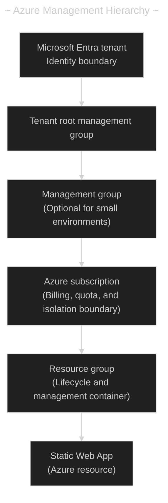
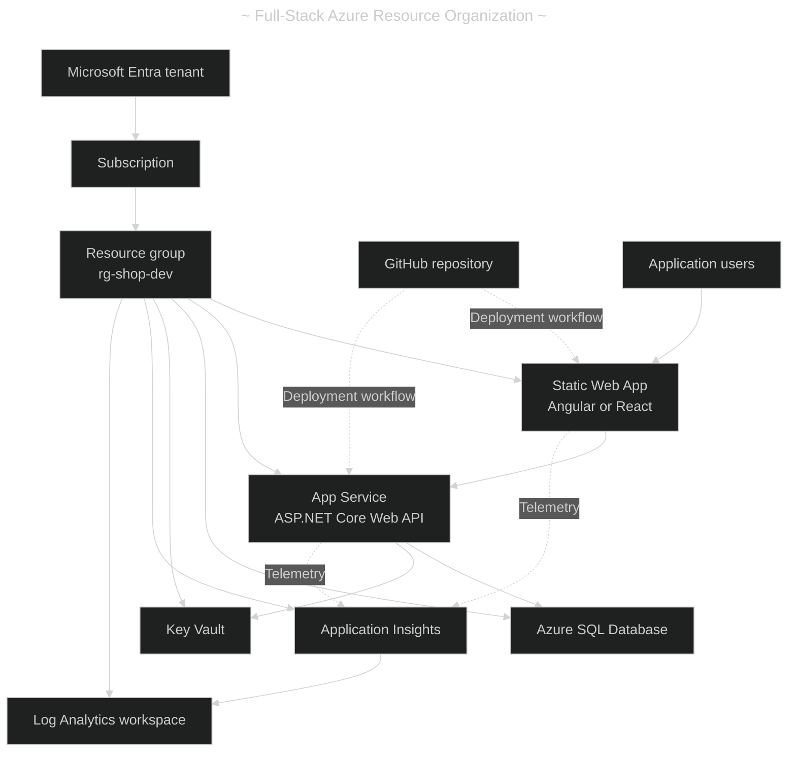

# Azure Resource Hierarchy: The Whole Picture

- [Azure Resource Hierarchy: The Whole Picture](#azure-resource-hierarchy-the-whole-picture)
	- [(1) Core Azure Hierarchy](#1-core-azure-hierarchy)
	- [(2) Static Web App Example](#2-static-web-app-example)
	- [(3) What Comes After the Static Web App](#3-what-comes-after-the-static-web-app)
		- [Managed API versus separate API](#managed-api-versus-separate-api)
	- [(4) Full-Stack Application Example](#4-full-stack-application-example)
	- [(5) Recommended Structure](#5-recommended-structure)
	- [(6) Important Distinctions](#6-important-distinctions)

---

## (1) Core Azure Hierarchy

The strict Azure Resource Manager hierarchy is:

```text
Microsoft Entra tenant
└── Management group
    └── Subscription
        └── Resource group
            └── Azure resource
```

Therefore, your understanding is almost correct:

```text
Subscription
└── Resource group (`rg-my-application`)
    ├── Azure resource A - Static Web App
    ├── Azure resource B - App Service
    ├── Azure resource C - Azure SQL Database
    └── Azure resource D - Key Vault
```

- A Static Web App is normally the final Azure Resource Manager resource in that chain. There is no mandatory general-purpose container beneath it.
- An "Static Web App" can be replaced with anything else? A Static Web App can be replaced with any other Azure resource:
  - Azure App Service
  - Azure Function App
  - Azure Container App
  - Azure SQL Database
  - Azure Storage account
  - Azure Key Vault
  - Azure Virtual Machine
  - Azure Kubernetes Service
  - Azure Virtual Network
  - Application Insights



- Azure officially defines four **Resource Manager management scopes**:
  1. management groups,
  2. subscriptions,
  3. resource groups,
  4. and resources.
- Policies and role assignments at higher scopes can be inherited by lower scopes. [Microsoft: Azure Resource Manager overview](https://learn.microsoft.com/azure/azure-resource-manager/management/overview)

|   # | Level                  | Example                      | Main purpose                                    |
| --: | ---------------------- | ---------------------------- | ----------------------------------------------- |
|   1 | Microsoft Entra tenant | `carlos-dev.onmicrosoft.com` | Users, groups, applications, and authentication |
|   2 | Management group       | `Personal-Projects`          | Governance across multiple subscriptions        |
|   3 | Subscription           | `Azure-Free-Subscription`    | Billing, quotas, access, and service boundaries |
|   4 | Resource group         | `rg-cloud-learning-dev`      | Groups resources sharing a lifecycle            |
|   5 | Resource               | `swa-cloud-learning-dev`     | The actual service being deployed               |

Management groups are useful primarily when you have multiple subscriptions. For a personal learning account, the tenant root management group may be sufficient.

---

## (2) Static Web App Example

A realistic small deployment would look like this:

```text
Microsoft Entra tenant
└── Azure subscription
    └── rg-cloud-learning-dev (Resource Group)
        ├── swa-cloud-learning-dev
        ├── appi-cloud-learning-dev
        ├── log-cloud-learning-dev
        └── etc.
```

|   # | Azure resource          | Purpose                               | Required? |
| --: | ----------------------- | ------------------------------------- | :-------: |
|   1 | Static Web App          | Hosts the compiled frontend           |    ✅     |
|   2 | Application Insights    | Application telemetry and diagnostics |    🤔     |
|   3 | Log Analytics workspace | Centralized logs and queries          |    🤔     |
|   4 | Azure Function App      | Separate serverless API               |    🤔     |
|   5 | Key Vault               | Secrets and certificates              |    🤔     |
|   6 | Azure SQL Database      | Relational application data           |    🤔     |

These are generally sibling resources inside the resource group. They are not nested inside the Static Web App.

---

## (3) What Comes After the Static Web App

Inside the Static Web App service, you configure service-specific features rather than another general Azure management level:

```text
Static Web App resource
├── Production environment
├── Preview environments
├── Application configuration
├── Environment variables
├── Custom domains
├── Authentication and authorization
├── Routing configuration
└── API integration
```

These are operational components or configurations of the resource, not additional management scopes comparable to resource groups.

|   # | Component                | Description                                                                  |
| --: | ------------------------ | ---------------------------------------------------------------------------- |
|   1 | Production environment   | Deployment generated from the production branch                              |
|   2 | Pull-request environment | Temporary deployment generated for a pull request                            |
|   3 | Branch environment       | Persistent preview deployment for another branch                             |
|   4 | Custom domain            | Domain mapped to the production application                                  |
|   5 | Managed certificate      | TLS certificate managed by Azure                                             |
|   6 | Application settings     | Environment-specific configuration values                                    |
|   7 | Managed API              | Azure Functions API managed as part of Static Web Apps                       |
|   8 | Linked backend           | Separate Function App, App Service, Container App, or API Management service |

Static Web Apps supports production, pull-request, branch, and named preview environments. [Microsoft: Static Web Apps preview environments](https://learn.microsoft.com/azure/static-web-apps/preview-environments)

### Managed API versus separate API

There are two important arrangements:

```text
Option A: Managed API

Resource group
└── Static Web App
    └── Managed Azure Functions API
```

The managed API is deployed with the Static Web App. You do not administer a separate Function App resource.

```text
Option B: Independent backend

Resource group
├── Static Web App
└── Function App / App Service / Container App
```

The backend is a separate Azure resource and usually appears beside the Static Web App in the resource group. Static Web Apps can link Azure Functions, App Service, Container Apps, or API Management as backends. [Microsoft: Static Web Apps API support](https://learn.microsoft.com/azure/static-web-apps/apis-overview)

---

## (4) Full-Stack Application Example

For an Angular or React frontend with an ASP\.NET Core API and SQL Server:



The important point is that architecture relationships do not define management containment:

- The Static Web App calls the API, but the API is not necessarily inside it.
- The API uses SQL Database, but SQL Database is not inside the API.
- They are normally sibling resources connected through URLs, identities, networking, and configuration.
- The GitHub repository is external to the Azure resource hierarchy.

---

## (5) Recommended Structure

For learning or a small personal project:

```text
Tenant
└── Subscription
    ├── rg-myapp-dev
    │   ├── swa-myapp-dev
    │   ├── app-myapp-api-dev
    │   ├── sql-myapp-dev
    │   └── appi-myapp-dev
    │
    └── rg-myapp-prod
        ├── swa-myapp-prod
        ├── app-myapp-api-prod
        ├── sql-myapp-prod
        └── appi-myapp-prod
```

For a larger production organization:

```text
Tenant
└── Management groups
    ├── Platform
    │   ├── Identity subscription
    │   ├── Connectivity subscription
    │   └── Management subscription
    │
    └── Workloads
        ├── Development subscription
        │   └── Development resource groups
        │
        └── Production subscription
            └── Production resource groups
```

Microsoft recommends organizing related resources by shared lifecycle and using separate subscriptions for environments when stronger production isolation is required. [Microsoft: Organize Azure resources](https://learn.microsoft.com/azure/cloud-adoption-framework/ready/azure-setup-guide/organize-resources)

---

## (6) Important Distinctions

|   # | Concept                    | Is it a hierarchy level? | Explanation                                                              |
| --: | -------------------------- | :----------------------: | ------------------------------------------------------------------------ |
|   1 | Region                     |            ❌            | A deployment-location property, not a parent container                   |
|   2 | Availability zone          |            ❌            | Physical resiliency boundary within supported regions                    |
|   3 | Resource group             |            ✅            | Contains Azure resources; cannot contain other resource groups           |
|   4 | Static Web App             |            ✅            | Resource beneath a resource group                                        |
|   5 | Static Web App environment |            ❌            | Service-specific deployment environment                                  |
|   6 | GitHub repository          |            ❌            | External source-code system connected to Azure                           |
|   7 | App Service plan           |            ❌            | Separate Azure resource used by App Service applications                 |
|   8 | Tags                       |            ❌            | Metadata for organization and cost reporting                             |
|   9 | Landing zone               |            ❌            | Architectural pattern composed of subscriptions, policies, and resources |
|  10 | Billing account            |            ❌            | Part of a separate billing hierarchy                                     |

Azure effectively has three overlapping structures:

```text
Identity:
Microsoft Entra tenant → Users, groups, and service principals

Governance:
Management group → Subscription → Resource group → Resource

Billing:
Billing account → Billing profile/invoice section → Subscription
```

Every subscription has a trust relationship with one Microsoft Entra tenant, while the billing relationship is managed separately. [Microsoft: Billing and tenant relationship](https://learn.microsoft.com/azure/cost-management-billing/understand/understand-billing-tenant-relationship)
